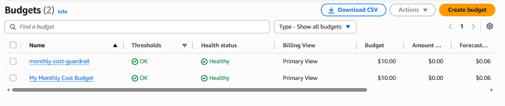

# Day 1 — Account guardrails

Secured a new AWS account and created a monthly cost budget with Terraform.

## What I built

- Root user protected with MFA, no root access keys
- Daily admin IAM user (`eswari-admin`) in an `admins` group, with MFA and no access keys
- AWS CLI signed in with `aws login`, which gives temporary credentials
- Monthly cost budget ($10) with email alerts at 80% actual spend and 100% forecast spend, created with Terraform

## Why these choices

| Decision | Why | Alternative |
| --- | --- | --- |
| IAM user + MFA | My account is on the AWS Free plan. Identity Center needs AWS Organizations, which ends the free credits immediately | IAM Identity Center (what a company would use) |
| Terraform | Works across clouds and is common in job ads | CloudFormation, AWS CDK |
| AWS Budgets | Alerts on forecast spend as well as actual spend | CloudWatch billing alarm, Cost Anomaly Detection |

## Files

- `terraform/providers.tf` — AWS provider and version
- `terraform/variables.tf` — region, profile, budget limit, alert email
- `terraform/main.tf` — the budget resource
- `terraform/outputs.tf` — prints the budget name

State and `.tfvars` files are not committed, because state can contain secrets.

## Run it

```
cd terraform
aws login --profile signin
terraform init
terraform plan
terraform apply
terraform destroy
```
## Result



## What I learned

- Root is for emergencies only; daily work uses a separate user with MFA
- Temporary credentials are safer than long-lived access keys
- `plan` shows the change before `apply` makes it